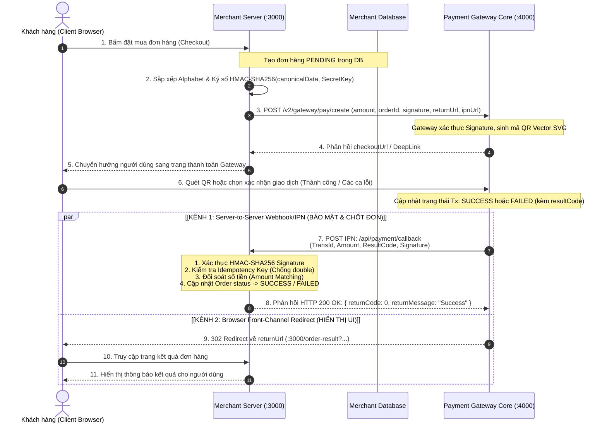

<p align="center">
  
  
  
  
</p>

<h1 align="center">🏦 E-Wallet End-to-End Payment Flow Simulator</h1>

<h3 align="center">
  Kiến trúc & Giả lập Tích hợp Cổng Thanh toán Ví Điện tử Thực tế (MoMo, ZaloPay, ShopeePay Standard)
</h3>

<p align="center">
  Dự án Case Study kỹ thuật chuyên sâu mô phỏng hoàn chỉnh luồng thanh toán hai chiều giữa <strong>Merchant System</strong> và <strong>Payment Gateway Core</strong>. Thiết kế chuẩn Fintech: bảo mật chữ ký số, cơ chế chống tấn công giả mạo (Anti-Tamper), xử lý bất đồng bộ IPN/Webhook và tính lũy thừa (Idempotency).
</p>

---

## 📌 Mục Lục
- [1. Đặt vấn đề & Động lực dự án](#-1-đặt-vấn-đề--động-lực-dự-án)
- [2. Sơ đồ Kiến trúc & Luồng Dữ liệu (Sequence Flow)](#-2-sơ-đồ-kiến-trúc--luồng-dữ-liệu-sequence-flow)
- [3. So sánh Hai Kênh: Redirect URL vs. IPN Webhook](#-3-so-sánh-hai-kênh-redirect-url-vs-ipn-webhook)
- [4. Các Trụ Cột Bảo Mật & Kỹ Thuật Cốt Lõi](#-4-các-trụ-cột-bảo-mật--kỹ-thuật-cốt-lõi)
  - [4.1 Chuẩn hóa Canonical String & Chữ ký HMAC-SHA256](#41-chuẩn-hóa-canonical-string--chữ-ký-hmac-sha256)
  - [4.2 Cơ chế chống tấn công đo thời gian (Timing Attack)](#42-cơ-chế-chống-tấn-công-đo-thời-gian-timing-attack)
  - [4.3 Tính lũy thừa (Idempotency) chống Replay Attack](#43-tính-lũy-thừa-idempotency-chống-replay-attack)
  - [4.4 Đối soát Số tiền (Amount Mismatch Detection)](#44-đối-soát-số-tiền-amount-mismatch-detection)
  - [4.5 Bộ sinh mã QR Vector SVG Offline](#45-bộ-sinh-mã-qr-vector-svg-offline)
- [5. Giả lập Các Ca Lỗi Thanh Toán Nghiệp Vụ (Failure Test Cases)](#-5-giả-lập-các-ca-lỗi-thanh-toán-nghiệp-vụ-failure-test-cases)
- [6. Cấu trúc Thư mục Dự án](#-6-cấu-trúc-thư-mục-dự-án)
- [7. Hướng dẫn Cài đặt & Trải nghiệm](#-7-hướng-dẫn-cài-đặt--trải-nghiệm)
- [8. Đối sánh Đặc tả Kỹ thuật: MoMo vs. ZaloPay](#-8-đối-sánh-đặc-tả-kỹ-thuật-momo-vs-zalopay)
- [9. Đóng góp & Tác giả](#-9-đóng-góp--tác-giả)

---

## 🎯 1. Đặt vấn đề & Động lực dự án

Khi tích hợp các cổng thanh toán ví điện tử hàng đầu tại Việt Nam (như MoMo, ZaloPay, ShopeePay hay VNPay), các kỹ sư thường mắc phải những sai lầm nghiêm trọng sau:
1. **Phụ thuộc vào Return URL (Redirect) để chốt đơn**: Khách thanh toán xong nhưng tắt trình duyệt hoặc mất kết nối mạng trước khi được chuyển hướng về website của Merchant, dẫn đến việc *tiền của khách đã bị trừ nhưng đơn hàng ở hệ thống thì không được duyệt*.
2. **Không xác thực hoặc xác thực sai Chữ ký số (HMAC-SHA256)**: Payload bị kẻ xấu (Man-in-the-Middle) can thiệp sửa đổi giá trị `amount`, `resultCode` hoặc `orderId` mà hệ thống không phát hiện được.
3. **Thiếu cơ chế Idempotency**: Khi Gateway retry gửi IPN (do timeout mạng), hệ thống xử lý callback 2 lần gây cộng tiền nhiều lần cho tài khoản hoặc gửi trùng đơn.
4. **Chỉ kiểm thử luồng thành công (Happy Path)**: Bỏ qua hàng loạt kịch bản lỗi biên như *số dư không đủ, ngân hàng từ chối, hết hạn phiên thanh toán, tài khoản vượt hạn mức*.

> **Giải pháp:** Dự án này được xây dựng như một **Case Study phân tích chuyên sâu**, cung cấp một môi trường giả lập 2 Server độc lập (Merchant & Gateway) có thể chạy **100% Offline (Zero Dependencies)**, giúp bạn hiểu rõ từng byte dữ liệu và luồng kiểm tra logic trước khi làm việc với API thực tế.

---

## 🔄 2. Sơ đồ Kiến trúc & Luồng Dữ liệu (Sequence Flow)

Dưới đây là luồng thanh toán end-to-end chuẩn theo mô hình kiến trúc của MoMo và ZaloPay:



---

## ⚖️ 3. So sánh Hai Kênh: Redirect URL vs. IPN Webhook

Hiểu rõ sự khác biệt giữa hai kênh này là quy tắc số 1 trong lập trình cổng thanh toán:

| Đặc Điểm | Front-Channel: Return / Redirect URL | Back-Channel: Webhook / IPN Callback |
| :--- | :--- | :--- |
| **Đường truyền** | Trình duyệt Client (Browser 302 Redirect) | Máy chủ đến Máy chủ (Server-to-Server HTTP POST) |
| **Mục đích** | **Chỉ phục vụ hiển thị trải nghiệm UI** cho người dùng | **Chốt trạng thái đơn hàng thực tế trong Cơ sở dữ liệu** |
| **Độ tin cậy** | **Thấp** (Người dùng có thể tắt app, ngắt wifi, đổi URL) | **Rất cao** (Gateway đảm bảo gửi trực tiếp kèm cơ chế Retry) |
| **Bảo mật** | Tham số truyền lộ thiên trên URL Query String | Gửi trong Request Body ngầm, có chữ ký số xác thực |
| **Hành động hệ thống** | Đọc dữ liệu hiển thị giao diện "Đang xử lý / Hoàn tất" | Kiểm tra chữ ký -> Khóa Idempotency -> Giao hàng / Nạp tiền |

---

## 🛡️ 4. Các Trụ Cột Bảo Mật & Kỹ Thuật Cốt Lõi

### 4.1 Chuẩn hóa Canonical String & Chữ ký HMAC-SHA256
Cả MoMo và ZaloPay đều yêu cầu toàn bộ dữ liệu trao đổi phải được ký số nhằm đảm bảo tính toàn vẹn (Integrity) và xác thực nguồn gốc (Authenticity).

1. **Quy tắc Canonicalization**: Các trường dữ liệu (key-value) bắt buộc phải được sắp xếp theo thứ tự bảng chữ cái (*ASCII Alphabetical Order*):
   ```
   amount=150000&appId=MERCHANT_DEMO_2026&appTransId=ORDER_123&...
   ```
2. **Ký số**: Dùng thuật toán HMAC với hàm băm SHA256 và `SecretKey` được cấp:
   ```javascript
   const signature = crypto
     .createHmac('sha256', secretKey)
     .update(canonicalQueryString)
     .digest('hex');
   ```

### 4.2 Cơ chế chống tấn công đo thời gian (Timing Attack)
Khi xác thực chữ ký của đối tác gửi sang, nếu dùng phép so sánh chuỗi thông thường (`sigA === sigB`), máy tính sẽ dừng ngay khi phát hiện ký tự khác nhau đầu tiên. Kẻ tấn công có thể đo thời gian phản hồi (tính bằng microsecond) để đoán dần từng ký tự của chữ ký hợp lệ.

Dự án sử dụng hàm so sánh thời gian bất biến:
```javascript
const expectedBuf = Buffer.from(expectedSignature, 'utf-8');
const computedBuf = Buffer.from(computedSignature, 'utf-8');
if (expectedBuf.length !== computedBuf.length) return false;

// So sánh an toàn chống Timing Attack
return crypto.timingSafeEqual(expectedBuf, computedBuf);
```

### 4.3 Tính lũy thừa (Idempotency) chống Replay Attack
Nếu Gateway gửi lại webhook do mạng chập chờn, hoặc kẻ xấu cố tình replay gói tin IPN cũ, hệ thống không được phép xử lý cộng tiền lần thứ hai.
Dự án áp dụng Idempotency Key:
```
IdempotencyKey = "ipn_" + gatewayTransId + "_" + resultCode
```
- Khi Webhook tới: Kiểm tra `hasProcessedIdempotencyKey(key)`.
- Nếu đã tồn tại: Lập tức trả về `HTTP 200 { returnCode: 0, message: "Already processed" }` và dừng thực thi logic kinh doanh.

### 4.4 Đối soát Số tiền (Amount Mismatch Detection)
Một lỗ hổng sơ đẳng thường gặp là Merchant chỉ kiểm tra xem `resultCode === 0` (thành công) hay không mà quên kiểm tra số tiền. Kẻ tấn công có thể tạo đơn hàng 1.000.000đ nhưng giả lập hoặc lừa cổng thanh toán gửi IPN cho đơn hàng 1.000đ.
Dự án cài đặt bước đối soát nghiêm ngặt:
```javascript
if (Number(order.amount) !== Number(ipnPayload.amount)) {
  // Lập tức từ chối, chuyển trạng thái đơn sang FAILED và báo động bảo mật
  return res.json({ returnCode: 4002, returnMessage: "Amount mismatch detected" }, 400);
}
```

### 4.5 Bộ sinh mã QR Vector SVG Offline
Dự án tự xây dựng thuật toán sinh mã **QR Code Model 2 (Byte Mode, Error Correction Level M)** bằng JavaScript nguyên bản (`src/common/qr.js`):
- Không phụ thuộc vào thư viện bên thứ ba.
- Tạo trực tiếp chuỗi SVG siêu nhẹ, sắc nét và hiển thị ngay trên trình duyệt mà không cần kết nối mạng.

---

## ⚠️ 5. Giả lập Các Ca Lỗi Thanh Toán Nghiệp Vụ (Failure Test Cases)

Để sẵn sàng cho môi trường Production, hệ thống tích hợp sẵn các nút bấm giả lập các trường hợp lỗi thường gặp:

| Mã Lỗi (`resultCode`) | Tiêu Đề Ca Lỗi | Kịch Bản Nghiệp Vụ Thực Tế | Phản Ứng Của Hệ Thống Merchant |
| :---: | :--- | :--- | :--- |
| **`0`** | **Giao dịch thành công** | Trừ tiền thành công, số dư khả dụng hợp lệ. | Cập nhật `SUCCESS`, gửi hàng hoặc kích hoạt gói. |
| **`4012`** | **Người dùng hủy giao dịch** | Khách bấm nút Hủy hoặc đóng ứng dụng ví. | Đổi trạng thái sang `FAILED`, hoàn kho giữ hàng. |
| **`4010`** | **Số dư ví không đủ** | Tài khoản ví / ngân hàng không đủ số dư. | Đổi trạng thái `FAILED`, hiển thị gợi ý nạp thêm tiền. |
| **`4018`** | **Ngân hàng từ chối trừ tiền** | Thẻ liên kết bị khóa hoặc hệ thống NAPAS bảo trì. | Đổi trạng thái `FAILED`, hướng dẫn đổi thẻ khác. |
| **`4015`** | **Giao dịch hết hạn (Timeout)** | Quá thời hạn quét QR (mặc định 15 phút). | Đóng phiên giao dịch, chuyển trạng thái `EXPIRED`. |
| **`4020`** | **Vượt hạn mức trong ngày** | Khách đạt trần hạn mức thanh toán ngày theo quy định NHNN. | Thông báo khách sử dụng phương thức thanh toán khác. |
| **`4002`** | **🚨 Tấn công giả mạo số tiền** | Hacker bắt gói tin sửa `amount` từ 150.000đ về 100đ. | **Hệ thống chặn đứng**: Merchant báo động Amount Mismatch! |

---

## 📂 6. Cấu trúc Thư mục Dự án

```
e-wallet-payment-simulator/
├── server.js               # Entry point chạy cả 2 server đồng thời (:3000 & :4000)
├── test-unit.js            # Bộ kiểm thử tự động thuật toán HMAC & State Machine
├── package.json            # Thông tin metadata dự án
├── README.md               # Tài liệu Case Study chuyên sâu
└── src/
    ├── common/             # Thư viện lõi dùng chung
    │   ├── config.js       # Secret key, cấu hình cổng & danh mục mã lỗi chuẩn
    │   ├── crypto.js       # Module chuẩn hóa Canonical & HMAC-SHA256
    │   ├── db.js           # Cơ sở dữ liệu in-memory & quản lý Idempotency
    │   ├── qr.js           # Bộ sinh mã QR Vector SVG thuần JavaScript
    │   └── mini-server.js  # Zero-dependency HTTP Web Router & Parser
    ├── gateway/            # MÔ PHỎNG CỔNG THANH TOÁN VÍ (:4000)
    │   └── gateway-server.js (Checkout Page, Render QR, IPN Dispatcher)
    └── merchant/           # MÔ PHỎNG CỬA HÀNG TRỰC TUYẾN (:3000)
        └── merchant-server.js (Storefront, Tạo đơn, Xử lý IPN, Order Result)
```

---

## 🚀 7. Hướng dẫn Cài đặt & Trải nghiệm

Dự án chạy trên **Node.js (phiên bản 18+ trở lên)** mà **không cần chạy `npm install`** bất kỳ package nào.

### Bước 1: Khởi động hệ thống
```bash
node server.js
```
Terminal sẽ hiển thị:
```text
================================================================
  🚀 E-WALLET END-TO-END PAYMENT FLOW SIMULATOR (MOMO / ZALOPAY)
================================================================
[GATEWAY]  🟢 Mock Payment Gateway Core listening on http://localhost:4000
[MERCHANT] 🟢 Merchant Web Store listening on http://localhost:3000
```

### Bước 2: Trải nghiệm trên trình duyệt
1. Mở trình duyệt và truy cập: **`http://localhost:3000`**
2. Nhấn nút **"⚡ Thanh toán ngay qua Ví"**.
3. Bạn sẽ được chuyển hướng sang trang Cổng thanh toán (:4000). Tại đây:
   - Thấy **Mã QR Vector SVG** hiển thị trực tiếp.
   - Bấm **"✓ Xác nhận Thanh toán Thành Công"** để chạy luồng chuẩn.
   - Hoặc bấm các nút trong mục **"2. Giả lập Các Ca Lỗi Thanh Toán Thực Tế"** (ví dụ: Thiếu số dư, Hết hạn, Hacker sửa giá tiền).
4. Quan sát:
   - **Terminal**: In log gửi Webhook Server-to-Server kèm chữ ký số.
   - **Giao diện Merchant**: Bảng **Nhật ký Webhook / IPN Audit** ghi nhận sự kiện thời gian thực kèm chi tiết payload JSON.

### Bước 3: Chạy Unit Test kiểm thử bảo mật
```bash
node test-unit.js
```
Kết quả kiểm thử 5 ca bảo mật:
- ✅ *Canonical Query & HMAC-SHA256 Signing*
- ✅ *Verifying Valid Signature*
- ✅ *Tampered Data Detection (Chống MITM)*
- ✅ *Idempotency Key Tracking & Double-Spending Protection*
- ✅ *Order Lifecycle State Machine*

---

## 📑 8. Đối sánh Đặc tả Kỹ thuật: MoMo vs. ZaloPay

| Tiêu Chí Kỹ Thuật | MoMo Payment API (v2) | ZaloPay Payment API (v2) | Mô Hình Simulator Này |
| :--- | :--- | :--- | :--- |
| **Thuật toán chữ ký** | HMAC-SHA256 | HMAC-SHA256 | HMAC-SHA256 chuẩn canonical |
| **Bộ thông tin định danh** | `partnerCode`, `accessKey`, `secretKey` | `app_id`, `key1` (request), `key2` (callback) | `appId`, `secretKey` symmetric |
| **Quy ước mã đơn hàng** | `orderId` & `requestId` | `app_trans_id` (format: `yymmdd_xxxx`) | `appTransId` |
| **Kênh xác nhận chốt đơn** | IPN (Server-to-Server) | Callback (Server-to-Server) | Asynchronous HTTP POST IPN |
| **Quy định mã thành công** | `resultCode === 0` | `return_code === 1` | `resultCode === 0` |
| **Cơ chế Retry Webhook** | Retry theo lũy thừa thời gian | Retry tối đa 3-5 lần | Đã tích hợp sẵn Idempotency guard |

---

## 👨‍💻 9. Đóng góp & Tác giả

Dự án được xây dựng với mục tiêu giáo dục, chia sẻ kiến thức cộng đồng và làm tài liệu minh họa kiến trúc cho các buổi phỏng vấn vị trí **Backend / Fullstack / Solution Architect trong ngành Fintech**.

- Nếu thấy hữu ích, hãy tặng dự án một ⭐️ **Star** trên GitHub!
- Giấy phép phân phối: **MIT License**.
