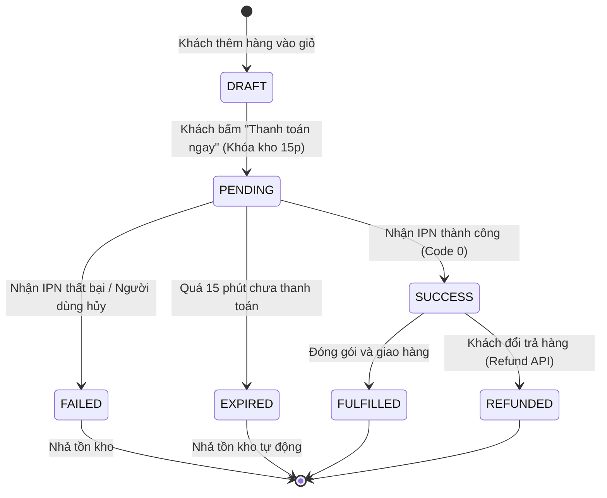

# 📊 Business Analysis & Requirement Specification: E-Wallet Integration
> **Tài liệu Phân tích Nghiệp vụ Tích hợp Cổng Thanh toán Ví Điện tử (MoMo & ZaloPay Standard)**  
> *Dành cho Business Analysts, Product Managers và Solution Architects.*

---

## 1. Tổng quan & Mục tiêu Kinh doanh (Business Context)

### 1.1 Vấn đề Nghiệp vụ (Problem Statement)
- Tỉ lệ bỏ giỏ hàng (Cart Abandonment Rate) tăng cao do khách hàng không mang thẻ ngân hàng hoặc ngại nhập số thẻ thủ công.
- Tỉ lệ từ chối nhận hàng (RTO - Return To Origin) của hình thức COD (Thanh toán khi nhận hàng) chiếm 12-15%, gây tổn thất chi phí vận hành và lưu kho.

### 1.2 Mục tiêu Dự án (Project Objectives & KPIs)
- Bổ sung 2 phương thức thanh toán trực tuyến không tiền mặt phổ biến nhất: **Ví MoMo** và **Ví ZaloPay**.
- Giảm tỉ lệ đơn COD xuống dưới 30% tổng số đơn hàng.
- Nâng cao tỉ lệ chuyển đổi thanh toán thành công (Payment Success Rate) đạt trên 96%.
- Đảm bảo tính toán đối soát tài chính khớp 100% giữa hệ thống nội bộ và đối tác ví.

---

## 2. Ma trận Phân tích Các bên Liên quan (Stakeholder Matrix)

| Stakeholder | Mối quan tâm chính | Vai trò trong dự án |
| :--- | :--- | :--- |
| **Khách hàng (End-user)** | Nhanh, bảo mật, quét mã tiện lợi, thấy ngay kết quả đơn hàng. | Người dùng cuối |
| **Phòng Kinh doanh / Marketing** | Chạy các chiến dịch voucher/khuyến mãi chéo từ ví. | Định nghĩa chương trình giá |
| **Phòng Kế toán (Finance/Acc)** | Phí thanh toán (MDR: ~1.1 - 2.2%), chu kỳ đối soát (T+1), xuất hóa đơn GTGT. | Thẩm định luồng đối soát |
| **Phòng Pháp chế (Legal)** | Điều khoản chấp nhận thanh toán, tuân thủ Nghị định 13/2023/NĐ-CP về dữ liệu cá nhân. | Ký kết hợp đồng đại lý |
| **Đội ngũ Kỹ thuật (Dev/QA)** | API specs, Webhook IPN, Signature HMAC-SHA256, Idempotency, UAT Sandbox. | Xây dựng & Kiểm thử |
| **CSKH (Customer Support)** | Tra cứu lịch sử thanh toán, hỗ trợ xử lý khiếu nại khách bị trừ tiền nhưng đơn treo. | Vận hành hàng ngày |

---

## 3. Đặc tả Yêu cầu Nghiệp vụ (Functional Requirements)

### 3.1 Nhóm chức năng Đặt hàng & Khởi tạo Thanh toán
- **FR-01**: Tại trang Checkout, hệ thống cho phép khách chọn kênh: "Ví MoMo" hoặc "Ví ZaloPay".
- **FR-02**: Khi khách bấm thanh toán, hệ thống tự động:
  - Sinh mã đơn hàng duy nhất (`appTransId`).
  - Ghi nhận trạng thái đơn hàng: `PENDING`.
  - Khóa tạm thời (Hold Stock) tồn kho sản phẩm với thời gian hết hạn (TTL) là **15 phút**.
  - Tính chữ ký số `HMAC-SHA256` theo chuẩn Canonical Query và gọi API đối tác để lấy `payUrl` / mã QR.

### 3.2 Nhóm chức năng Quét QR & Xử lý Giao dịch
- **FR-03**: Hệ thống hiển thị mã QR động chuẩn Vector SVG cùng bộ đếm ngược thời gian (15:00).
- **FR-04**: Cho phép khách quét qua app ví hoặc bấm mở deep-link trên điện thoại.

### 3.3 Nhóm chức năng Nhận thông báo (IPN) & Chốt trạng thái Đơn hàng
- **FR-05 (Server-to-Server Callback)**: Hệ thống phải có endpoint nhận dữ liệu IPN ngầm từ Cổng ví.
- **FR-06 (Bảo mật 3 lớp tại IPN)**:
  - *Lớp 1 (Chữ ký số)*: Kiểm tra chữ ký HMAC-SHA256 từ Gateway gửi về.
  - *Lớp 2 (Idempotency)*: Kiểm tra khóa trùng lặp (`ipn_{transId}_{resultCode}`) để chống double-spending.
  - *Lớp 3 (Đối soát số tiền)*: Kiểm tra `order.amount === ipn.amount`.
- **FR-07 (Cập nhật trạng thái)**:
  - Nếu `resultCode === 0`: Đơn hàng đổi thành `SUCCESS / PAID` -> Kích hoạt xuất kho & gửi email hóa đơn.
  - Nếu `resultCode !== 0`: Đơn hàng đổi thành `FAILED` -> Mở khóa tồn kho (Release Stock).

---

## 4. Ma trận Trạng thái Đơn hàng (State Machine Diagram)



---

## 5. Ma trận Xử lý Tình huống Ngoại lệ (Edge Case Handling Matrix)

| STT | Tình huống ngoại lệ (Edge Case) | Rủi ro kinh doanh | Giải pháp BA quy định trong SRS |
| :---: | :--- | :--- | :--- |
| **1** | **Khách bị trừ tiền nhưng web báo "Đang xử lý"** (do IPN về chậm hoặc rớt mạng). | Khách hoang mang, khiếu nại CSKH, hủy đơn. | Không hiển thị "Thất bại". Hiển thị trạng thái "Đang xác nhận", tự động thăm dò (Polling) qua API `Query Order Status` định kỳ 5 giây/lần. |
| **2** | **Gateway gửi Webhook trùng lặp 3 lần** (do cơ chế Retry khi timeout). | Đơn hàng bị xuất kho 2 lần hoặc cộng điểm thành viên 2 lần. | Áp dụng **Idempotency Key**: Hệ thống chỉ xử lý logic kinh doanh ở lần đầu, các lần sau lập tức trả về `HTTP 200 { returnCode: 0 }`. |
| **3** | **Khách thanh toán vào giây thứ 14:59 (Trễ hạn)**. Đơn vừa bị hủy thì tiền vừa bị trừ. | Khách mất tiền nhưng đơn hàng bị hủy kho. | Hệ thống chuyển đơn sang trạng thái `DISCREPANCY_FLAG`, tự động kích hoạt gọi API `refund` hoàn tiền hoặc tạo vé hỗ trợ khẩn cấp cho CSKH. |
| **4** | **Hacker can thiệp sửa giá trị gói tin** (Amount Tampering). | Mua hàng giá trị cao với số tiền 1.000đ. | Chữ ký HMAC bị lệch -> Chặn đứng ngay tại Gateway. Nếu lọt qua được, Merchant kiểm tra `order.amount !== ipn.amount` -> Lập tức khóa đơn. |

---

## 6. Quy trình Đối soát Tài chính Định kỳ (Reconciliation & Settlement)

```
[01:00 AM Hàng ngày]
Gateway tự động xuất File Đối soát (Statement: *.xlsx / *.csv)
       │
       ▼
[Hệ thống Đối soát Tự động của Merchant]
So khớp 3 chiều (3-Way Matching):
   (1) Báo cáo giao dịch từ Cổng Ví
   (2) Dữ liệu đơn hàng trạng thái PAID trong DB nội bộ
   (3) Biến động số dư tài khoản Ngân hàng (Settlement Bank)
       │
       ├── Khớp 100% ────> Đóng sổ tài chính ngày (Reconciled)
       └── Lệch tiền ────> Báo động & xuất danh sách Discrepancy cho Kế toán xử lý
```

---

## 7. Kế hoạch Kiểm thử Chấp nhận Người dùng (UAT Checklist)

- [ ] **TC-01 (Happy Path)**: Thanh toán thành công với số tiền 150.000đ -> Đơn cập nhật `PAID`, tồn kho trừ.
- [ ] **TC-02 (User Cancel)**: Khách bấm Hủy trên màn hình ví -> Đơn chuyển `FAILED`, nhả tồn kho.
- [ ] **TC-03 (Insufficient Balance)**: Tài khoản không đủ tiền -> Báo lỗi mã `4010`, hướng dẫn nạp tiền.
- [ ] **TC-04 (Timeout Expiry)**: Chờ quá 15 phút -> Mã QR hết hiệu lực, hệ thống tự động hủy đơn.
- [ ] **TC-05 (Replay Webhook)**: Giả lập gửi lại Webhook 2 lần -> Hệ thống không xử lý trùng lặp.
- [ ] **TC-06 (Amount Tampering)**: Thử gửi IPN với số tiền khác số tiền gốc -> Bị Merchant phát hiện và chặn lại.
