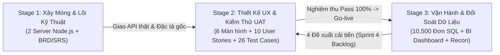

# 📘 Cẩm Nang Toàn Tập 3 Stage: Hiểu Sâu Hệ Thống Thanh Toán Ví Điện Tử Từ Con Số 0

> [!TIP]
> Tài liệu này được viết theo nguyên tắc **"Giải thích từ gốc rễ bằng ví dụ đời thường"**. Dù bạn chưa từng code cổng thanh toán hay chưa từng làm ở công ty Fintech, đọc xong file này bạn sẽ nắm trọn vẹn 100% logic của cả 3 dự án như chính người thiết kế ra nó.

---

## 1. Từ Điển "Đời Thường Hóa" — 8 Khái Niệm Sống Còn Của Dự Án

Hãy tưởng tượng bạn mở một **tiệm bán tai nghe online** (giá `150.000 đ`). Khách hàng muốn trả tiền qua **MoMo** hoặc **ZaloPay**. Có **3 nhân vật** tham gia vào câu chuyện này:

1. **Merchant (Cửa hàng của bạn)**: Website bán tai nghe (`localhost:3000`). Nhiệm vụ: quản lý giỏ hàng, giữ tồn kho, giao tai nghe khi chắc chắn đã thu được tiền.
2. **Payment Gateway (Cổng thanh toán Ví — MoMo / ZaloPay)**: Hệ thống trung gian thu hộ tiền (`localhost:4000`). Nhiệm vụ: tạo mã QR, trừ tiền trong ví khách, rồi báo kết quả về cho cửa hàng.
3. **Bank Settlement (Ngân hàng thanh toán / Sao kê đối soát)**: Cuối mỗi ngày (hoặc hôm sau `T+1`), tiền thật từ Ví mới được chuyển cục bộ về tài khoản ngân hàng của cửa hàng kèm theo một tờ sao kê.

Để không bị mất tiền hay giao nhầm hàng, hệ thống xoay quanh **8 khái niệm cốt lõi** sau:

| Khái niệm chuyên môn | Ví dụ đời thường dễ hiểu | Vai trò trong 3 Stage |
| :--- | :--- | :--- |
| **1. Redirect URL (Return URL)** | Khách trả tiền xong ở quầy thu ngân, tự cầm hóa đơn giấy đi bộ quay lại quầy lấy hàng. | Chuyển trình duyệt của khách từ trang QR về trang Biên lai (`/order-result`). **Không đáng tin 100%** vì khách có thể rớt mạng hoặc tắt tab giữa chừng. |
| **2. IPN / Webhook (Callback ngầm)** | Thu ngân gọi bộ đàm **trực tiếp** vào tai quản lý kho: *"Đơn #123 thu đủ 150k rồi nhé!"* — bất kể khách có quay lại quầy hay mất mạng. | Cuộc gọi ngầm giữa 2 máy chủ (`Gateway -> Merchant /api/payment/callback`). **Đây mới là căn cứ duy nhất để chốt đơn `SUCCESS`.** |
| **3. Chữ ký số `HMAC-SHA256`** | Con dấu sáp niêm phong mật mà chỉ Cửa hàng và Ví biết khuôn đúc (`SECRET_KEY`). | Nếu kẻ gian chặn đường sửa số tiền từ `150.000đ` thành `100đ`, con dấu lập tức bị lệch → Hệ thống phát hiện giả mạo và chặn đứng ngay. |
| **4. Tính lũy thừa (`Idempotency`)** | Vé xem phim có mã vạch: quét lần 1 thì mở cửa; quét lại lần 2, lần 3 do máy lag thì màn hình chỉ báo *"Vé này vào rồi"* chứ không cho thêm người vào. | Khi mạng chập chờn, Ví sợ Cửa hàng chưa nghe thấy nên gọi báo IPN lặp lại 3–5 lần. Nhờ `idempotencyKey`, Cửa hàng chỉ xuất kho **đúng 1 lần**. |
| **5. Giữ kho 15 phút (`15-Min Hold`)** | Giữ ghế rạp chiếu phim trong 15 phút chờ bạn chuyển khoản. Quá 15 phút chưa trả tiền thì ghế tự mở lại cho người khác mua. | Tránh tình trạng **bán lố tồn kho (Overselling)** khi chỉ còn 1 chiếc tai nghe mà 2 người cùng bấm mua. |
| **6. Chủ động hỏi thăm (`Active Polling`)** | Khách bảo *"Tôi chuyển khoản rồi!"* nhưng bộ đàm kho chưa thấy báo → Nhân viên chủ động bấm máy gọi sang Ví hỏi 5 giây/lần. | Ở Stage 2 (`US-10`), khi mạng lag giờ cao điểm, web hiển thị *"Đang xác nhận..."* và gọi `/v2/gateway/pay/query` thay vì báo lỗi làm khách sợ. |
| **7. Phí cổng ví (`MDR Fee`)** | Tiền hoa hồng trả cho MoMo (1.5%) hoặc ZaloPay (1.3%) trên mỗi đơn thành công. | Dùng ở Stage 3 để tính chi phí thực tế (`62,92 triệu đ`) và đề xuất điều hướng sang ví có phí rẻ hơn. |
| **8. Đối soát 3 bên (`3-Way Recon`)** | Sáng hôm sau, Kế toán đặt **3 cuốn sổ** cạnh nhau: *Sổ Cửa Hàng*, *Sổ Log Ví*, và *Sao Kê Ngân Hàng* để dò từng dòng xem có lệch đồng nào không. | Trọng tâm của Stage 3: dùng SQL lôi ra chính xác **198 đơn bất thường** (lệch tiền hoặc mất IPN) trị giá `2.101.000 đ`. |

---

## 2. Bức Tranh Toàn Cảnh: Tại Sao Lại Tách Thành 3 Stage Liên Hoàn?

Trong một công ty công nghệ thật (như MoMo, VNG, Shopee, Tiki), một sản phẩm không bao giờ chỉ có "viết code xong là hết". Nó đi qua **3 giai đoạn nối tiếp nhau**, trong đó đầu ra của giai đoạn trước nuôi sống giai đoạn sau:



- **Stage 1 (`e-wallet-payment-simulator`) — Góc nhìn Kiến trúc & Lõi (Build)**: Chứng minh bạn hiểu sâu bên dưới nắp ca-pô hệ thống thanh toán vận hành ra sao (tự dựng 2 server độc lập chạy thật trên máy, tự ký `HMAC-SHA256`, tự bắn `IPN`).
- **Stage 2 (`e-wallet-checkout-ux-uat`) — Góc nhìn Agile BA & QA trước giờ G (Pre-launch)**: Có lõi rồi thì phải vẽ giao diện cho người dùng cuối, viết tài liệu `Given - When - Then` cho Dev làm không sai lệch, và lập 26 bài test "tra tấn" hệ thống trước khi mở cửa đón khách thật.
- **Stage 3 (`e-wallet-post-launch-analytics`) — Góc nhìn Dữ liệu & Tài chính sau 1 tháng (Post-launch)**: Mở cửa chạy 30 ngày có `10.500` đơn hàng rồi thì ITBA phải dùng SQL trả lời sếp: *"Khách đang bỏ cuộc ở bước nào nhiều nhất? Giờ nào hệ thống bị nghẽn? Tiền về ngân hàng có khớp 100% với đơn đã giao không?"*

---

## 3. Mổ Xẻ Chi Tiết Từng Stage (Đọc Tới Đâu Hiểu Tới Đó)

### 🏗️ Stage 1: `e-wallet-payment-simulator` (Hệ Thống Giả Lập Đầu-Cuối)

> **Link GitHub**: https://github.com/phucdatphan/e-wallet-payment-simulator

#### Chuyện gì xảy ra khi bạn chạy `npm start` và bấm "Thanh toán"?
1. Bạn mở `http://localhost:3000` (**Cửa hàng Merchant**): Chọn ví MoMo hoặc ZaloPay, bấm thanh toán `150.000 đ`.
2. **Merchant (`merchant-server.js`)** tạo mã đơn `ORDER_...` ở trạng thái `PENDING`, sắp xếp các trường dữ liệu theo thứ tự bảng chữ cái (`Canonical String`), đóng dấu `HMAC-SHA256`, rồi gọi sang cổng `4000`.
3. **Gateway (`gateway-server.js`)** kiểm tra con dấu hợp lệ → sinh mã QR Vector SVG thật ngay trên máy và mở trang cổng ví `http://localhost:4000/checkout?transId=...` kèm đồng hồ đếm ngược `15:00`.
4. Tại trang Cổng Ví, bạn có **2 lựa chọn**:
   - Bấm **Xác nhận Thành Công (Code 0)** → Gateway lập tức bắn gói tin **IPN ngầm** về `localhost:3000/api/payment/callback` VÀ chuyển trình duyệt của bạn về trang Biên lai `/order-result`.
   - Hoặc bấm **1 trong 6 nút phá hoại / lỗi thực tế** (Hủy đơn `4012`, Thiếu số dư `4010`, Ngân hàng từ chối `4018`, Hết hạn `4015`, Vượt hạn mức `4020`, hoặc **Hacker sửa tiền thành 100đ**).
5. **Merchant nhận IPN ngầm** và kiểm tra **3 lớp khiên bảo vệ**:
   - *Khiên 1*: Chữ ký `HMAC-SHA256` có đúng không? (Sai → Chặn đứng `400`).
   - *Khiên 2*: Khóa `ipn_{transId}_{resultCode}` đã xử lý trước đó chưa? (Rồi → Trả `200 Already processed`, không trừ kho lần 2).
   - *Khiên 3*: Số tiền trong IPN có bằng đúng `150.000 đ` của đơn gốc không? (Nếu bị sửa thành `100 đ` → Hú còi báo động `AMOUNT_MISMATCH`, đánh trượt đơn thành `FAILED` ngay lập tức!).

#### Ý nghĩa từng file trong Stage 1:
- `docs/BUSINESS_ANALYSIS.md`: Tài liệu phân tích nghiệp vụ gốc (BRD/SRS) — nêu bài toán giảm đơn COD hoàn hàng, ma trận các bên liên quan, sơ đồ trạng thái đơn hàng.
- `docs/AGILE_SCRUM_ROADMAP.md`: Bản đồ lộ trình Agile/Scrum nối kết cả 3 Stage.
- `src/common/crypto.js`: Nơi viết hàm sắp xếp tham số và ký `HMAC-SHA256` + so sánh chống tấn công đo thời gian (`timingSafeEqual`).
- `src/merchant/merchant-server.js` & `src/gateway/gateway-server.js`: Giao diện v2.0 và toàn bộ API của Cửa hàng (`:3000`) & Cổng Ví (`:4000`).
- `test-unit.js` & `test.js`: Bộ kiểm thử tự động chứng minh cả 5 bài test mã hóa và 4 bài test luồng E2E đều đạt 100%.

---

### 🎨 Stage 2: `e-wallet-checkout-ux-uat` (UX Studio, User Stories & Kiểm Thử UAT)

> **Link GitHub**: https://github.com/phucdatphan/e-wallet-checkout-ux-uat

Stage 2 biến các quy tắc khô khan ở Stage 1 thành sản phẩm nhìn thấy được và kiểm chứng được theo quy trình **Scrum (Sprint 1 & Sprint 2)**:

1. **`wireframes/user-journey-wireframes.html` (Interactive UX Studio v2.0)**:
   - Thiết kế **6 màn hình điện thoại** hoàn chỉnh:
     - `Screen 01`: Trang Checkout chọn MoMo / ZaloPay (khóa nút ngay khi bấm để chống bấm đúp).
     - `Screen 02`: Trang mã QR + Đồng hồ đếm ngược `15:00` + Nút mở nhanh ứng dụng ví (*One-Tap Deep-link*).
     - `Screen 03` *(Điểm ăn tiền của BA)*: Màn hình **Đang xác nhận giao dịch (Active Polling)** khi mạng chậm — tuyệt đối không báo "Thất bại" vội để khách không trả tiền 2 lần.
     - `Screen 04`: Biên lai Thành công (`PAID`).
     - `Screen 05`: Hết hạn 15 phút (`EXPIRED` — nhả kho tự động + ghi chú xử lý ca khó khách quét lúc `14:59`).
     - `Screen 06`: Hủy đơn / Thất bại (`FAILED` — mời đổi sang ví khác).
   - Có nút bật/tắt **Ghi chú BA**, đổi màu thương hiệu **MoMo ↔ ZaloPay**, và chế độ bấm chạy thử từng bước như app thật.

2. **`user-stories-ac.md` (10 User Stories chuẩn Gherkin)**:
   - Viết theo cấu trúc quốc tế: `As a [Ai] / I want [Muốn gì] / So that [Để đạt giá trị gì]`, đi kèm tiêu chí nghiệm thu `Given (Giả sử) - When (Khi) - Then (Thì)`.
   - Đặc biệt ở `US-05` có quy định rõ cơ chế **Exponential Backoff** (nếu server cửa hàng nghẽn, cổng ví tự động thử gửi lại sau `15 giây → 1 phút → 5 phút → 15 phút → 60 phút`) và **Dead Letter Queue (DLQ)** (quá 5 lần vẫn lỗi thì cất vào kho riêng và báo động cho nhân viên vận hành).

3. **`uat-test-cases.csv` (26 Kịch bản Kiểm thử UAT) & `postman/`**:
   - Bảng 26 ca kiểm thử bao phủ từ luồng đẹp đến các ca hiểm hóc: 2 người cùng mua chiếc tai nghe cuối cùng trong kho (`TC-24`), bấm thanh toán 2 lần trong nửa giây (`TC-05`), thanh toán đúng giây `14:59` (`TC-14`).
   - File Postman Collection giúp QA nạp vào phần mềm Postman và bắn thử trực tiếp vào máy chủ Stage 1.

---

### 📊 Stage 3: `e-wallet-post-launch-analytics` (Phân Tích Phễu & Đối Soát 3 Bên)

> **Link GitHub**: https://github.com/phucdatphan/e-wallet-post-launch-analytics

Giả sử sau khi vượt qua Stage 2, sản phẩm đã ra mắt được **30 ngày**. Bạn thu về một kho dữ liệu SQLite (`ewallet_analytics.db`) do `generate_data.py` tạo ra gồm:
- `10.500` dòng trong bảng `merchant_orders` (Sổ Cửa Hàng).
- `9.944` dòng trong bảng `gateway_transactions` (Sổ Cổng Ví).
- `7.550` dòng trong bảng `bank_settlements` (Sao Kê Ngân Hàng).

Từ kho dữ liệu này, file `analytics_queries.sql` dùng **8 câu truy vấn SQL chuyên sâu** tìm ra **4 sự thật kinh doanh đắt giá** (hiển thị trực quan trên `dashboard/index.html` và ảnh `charts/dashboard_overview.png`):

1. **Sự thật 1 — Điểm nghẽn rớt đơn 24.07% ở màn hình QR (Query #1 - Checkout Funnel)**:
   - Có `10.500` người tạo đơn → `9.944` người mở tới trang QR (chỉ rớt `5.30%`), nhưng từ lúc mở trang QR đến lúc trả tiền xong chỉ còn `7.550` người (**rớt tới `24.07%`**, tương đương `2.394` đơn bị bỏ dở!).
   - *Giải pháp của BA*: Khách dùng điện thoại ngại chụp màn hình mã QR rồi mở app ví quét lại → Phải làm nổi bật nút **Mở thẳng App Ví (One-Tap Deep-link)** và gửi thông báo nhắc ở phút thứ 10.

2. **Sự thật 2 — Nghẽn cổ chai khung giờ vàng 19h–21h tối (Query #2 - Peak Hours)**:
   - Ban ngày, IPN chỉ mất khoảng `~780–810 ms` (chưa tới 1 giây). Nhưng từ **19h đến 21h tối**, lượng người mua tăng gấp đôi làm độ trễ vọt lên **`2.313 – 2.502 ms`** (gấp hơn 3 lần!).
   - *Giải pháp của BA*: Đưa **Hàng đợi tin nhắn (Message Queue như Kafka/RabbitMQ)** vào đứng nhận IPN. Hễ Ví gọi sang là nhận thư và đáp `200 OK` ngay trong chớp mắt (`< 100ms`), sau đó bên trong mới thong thả trừ kho và gửi email hóa đơn.

3. **Sự thật 3 — Phát hiện 198 đơn lệch đối soát trị giá 2.101.000 đ & Lệch giờ khóa sổ T+2 (Query #4, #5, #8)**:
   - Khi khớp 3 bảng với nhau, SQL bắt tận tay:
     - **103 đơn `AMOUNT_MISMATCH`**: Cửa hàng ghi thu đủ nhưng sao kê ngân hàng chuyển về bị thiếu (tổng thiếu `2.030.000 đ`).
     - **95 đơn `MISSING_IPN`**: Tiền đã nằm trong ngân hàng nhưng log IPN bị thất lạc trên đường truyền.
     - **Lỗi Cut-off Time nửa đêm (Query #8)**: Các đơn mua lúc `23:45 – 23:59` đêm (như `ORD_002285` lúc `23:54:34` ngày 11/11) không kịp chốt sổ ngày hôm sau (`T+1`) mà bị đẩy sang tận ngày `13/11` (`T+2`). Nếu Kế toán không hiểu quy luật này sẽ tưởng nhầm là mất tiền!

4. **Sự thật 4 — Cơ hội tiết kiệm chi phí phí cổng ví MDR (Query #3)**:
   - ZaloPay có tỷ lệ thanh toán thành công nhỉnh hơn (`72.23%` so với `71.66%` của MoMo) trong khi phí MDR rẻ hơn (`1.3%` so với `1.5%`). Chỉ cần ưu tiên gợi ý ZaloPay hợp lý sẽ tiết kiệm đáng kể trên tổng phí `62,92 triệu đ/tháng`.

*(Ngoài ra, Stage 3 còn đính kèm phần mở rộng phân tích tập dữ liệu thực tế `284.807` giao dịch thẻ tín dụng tại `eda_creditcard.py` & `charts/creditcard_eda.png`, chỉ ra rủi ro gian lận cao bất thường ở các giao dịch `0 đồng` và khung giờ `2h–4h sáng`).*

---

## 4. "Bí Kíp Phòng Thi" — Cách Trả Lời 5 Câu Hỏi Xoáy Của Nhà Tuyển Dụng

> [!IMPORTANT]
> Khi đi phỏng vấn vị trí Business Analyst / System Analyst / Product Owner, bạn không cần đọc thuộc lòng code. Hãy trả lời theo đúng tư duy dưới đây:

1. **Hỏi: *"Tại sao em không chốt đơn hàng ngay tại trang `/order-result` khi khách được chuyển hướng về cho nhanh, mà phải làm IPN Webhook phức tạp?"***
   - **Đáp**: Vì `Redirect URL` đi qua trình duyệt của khách hàng — thứ mà ta không kiểm soát được. Thứ nhất, khách vừa bị trừ tiền xong mà rớt 4G hoặc lỡ tay vuốt tắt app thì đơn hàng sẽ bị treo dù tiền đã mất. Thứ hai, thông số trên thanh địa chỉ trình duyệt có thể bị can thiệp. Do đó, `Redirect URL` chỉ dùng để **hiển thị giao diện cho khách yên tâm**, còn việc **chốt đơn và trừ tồn kho bắt buộc phải dựa vào kênh Server-to-Server IPN** có xác thực chữ ký `HMAC-SHA256`.

2. **Hỏi: *"Nếu khách bấm thanh toán lúc phút thứ 14:59, đến 15:00 hệ thống của em vừa hủy đơn và nhả tồn kho cho người khác mua mất, thì đúng 15:01 IPN báo trừ tiền thành công mới bay về. Em xử lý sao?"***
   - **Đáp**: Đây chính là Edge Case `US-08` em đã đặc tả ở Stage 2. Khi đơn đã ở trạng thái `EXPIRED` (vì tồn kho đã nhả cho người khác nên không thể liều lĩnh chuyển lại thành `PAID` kẻo âm kho), hệ thống sẽ chặn không chốt đơn, chuyển sang cờ cảnh báo `DISCREPANCY_FLAG` (`REFUND_REQUIRED`), đồng thời tự động gọi **Refund API** hoàn tiền ngay về ví cho khách và bắn thông báo cho CSKH chăm sóc.

3. **Hỏi: *"Cổng ví gửi trùng IPN 3 lần thì hệ thống em phản hồi mã HTTP bao nhiêu ở lần thứ 2 và thứ 3?"***
   - **Đáp**: Bắt buộc vẫn phải trả về **`HTTP 200 OK` kèm `returnCode: 0`** (chứ không trả lỗi `400` hay `409`)! Vì nếu mình trả lỗi, cổng ví sẽ tưởng máy chủ mình bị sập và cứ tiếp tục retry mãi. Bí quyết là ở bên trong, nhờ kiểm tra `idempotencyKey` (`ipn_{transId}_{resultCode}`) đã tồn tại, mình bỏ qua toàn bộ bước trừ kho/gửi mail và trả `200 OK` ngay lập tức.

4. **Hỏi: *"Đối soát 3 bên khác gì đối soát 2 bên? Tại sao phải đối soát cả 3?"***
   - **Đáp**: Nếu chỉ đối soát 2 bên (Cửa hàng vs Cổng Ví), ta chỉ biết Ví *hứa* đã thu tiền, nhưng không chắc tiền thật đã chảy vào tài khoản ngân hàng hay bị cấn trừ sai phí MDR/voucher đồng tài trợ hay chưa. Đối soát 3 bên (**Merchant Orders × Gateway Logs × Bank Settlement**) giúp khóa chặt đường đi của dòng tiền từ lúc bấm mua đến lúc tiền nằm yên trong ngân hàng.

5. **Hỏi: *"Từ số liệu ở Stage 3, quyết định sản phẩm nào của em mang lại tác động kinh doanh lớn nhất?"***
   - **Đáp**: Giải quyết tỷ lệ rớt đơn **`24.07%`** tại bước quét mã QR (`2.394` đơn bị bỏ dở trong 1 tháng). Chỉ cần triển khai **One-Tap Deep-link** tự mở app ví trên điện thoại để kéo giảm một nửa lượng rớt đơn này, doanh thu thành công (GMV) của cửa hàng sẽ tăng thêm hơn **15%** mà không tốn thêm một đồng chi phí quảng cáo thu hút khách mới nào!

---

## 5. Cách Tự Tay Bấm Xem Toàn Bộ Giao Diện Mới Của Cả 3 Stage

Bạn có thể mở xem ngay lập tức vẻ đẹp của bộ giao diện Design v2.0 vừa nâng cấp trên máy của mình:

1. **Trải nghiệm Stage 1 (2 Server chạy thật)**:
   ```bash
   cd /Users/admin2004/.gemini/antigravity/scratch/e-wallet-payment-simulator
   npm start
   ```
   Sau đó mở trình duyệt vào `http://localhost:3000`, chọn thử **MoMo** rồi **ZaloPay** để thấy màu sắc cổng thanh toán tự động biến đổi theo từng ví!

2. **Trải nghiệm Stage 2 (Interactive UX Studio 6 màn hình)**:
   - Mở trực tiếp file [user-journey-wireframes.html](file:///Users/admin2004/.gemini/antigravity/scratch/e-wallet-checkout-ux-uat/wireframes/user-journey-wireframes.html) trên trình duyệt — bấm thử nút **"📱 Chạy thử Prototype"**, đổi qua lại **MoMo / ZaloPay** và bật/tắt **"🔍 Ghi chú BA"**.

3. **Trải nghiệm Stage 3 (BI & 3-Way Reconciliation Dashboard)**:
   - Mở trực tiếp file [dashboard/index.html](file:///Users/admin2004/.gemini/antigravity/scratch/e-wallet-post-launch-analytics/dashboard/index.html) trên trình duyệt — thử rà chuột lên biểu đồ độ trễ 24 giờ, bấm lọc các loại lệch đối soát và chuyển đổi chế độ **Tối / Sáng**.
